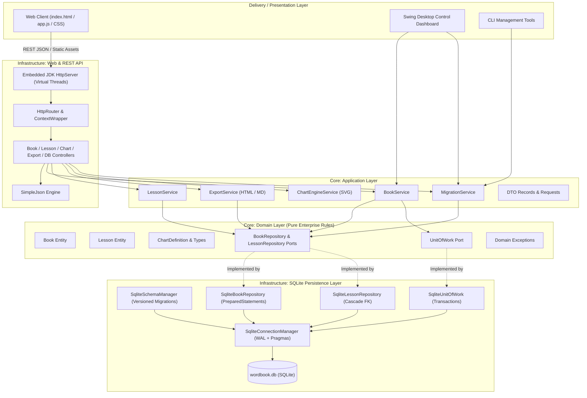

# Mikey Note — Modern Modular Java & SQLite Document Studio

<div align="center">
  
  <p><b>A modern document studio and notebook environment re-engineered with an Advanced Modular Architecture in Java 24, SQLite ACID persistence, and native Java Swing/AWT desktop studio with Adobe-style splash.</b></p>
</div>

---

## 🏛️ System Architecture

WordBook strictly follows Clean Architecture and Domain-Driven Design (DDD) principles. Invariants and business logic remain completely decoupled from database drivers and network frameworks.



---

## 📦 Modular Package Structure

```
com.wordbook
├── WordBookApplication.java                   # Main bootstrap & CLI entry point
│
├── core/
│   ├── domain/                                # Enterprise Business Rules
│   │   ├── model/
│   │   │   ├── Book.java                      # Book entity (id, title, color, timestamps)
│   │   │   ├── Lesson.java                    # Lesson entity (word/char counters, HTML)
│   │   │   ├── BookStatistics.java            # Value object for system metrics
│   │   │   └── ChartDefinition.java           # Chart specification & ChartType enum
│   │   ├── repository/                        # Inversion of Control Ports
│   │   │   ├── BookRepository.java            # Book repository port
│   │   │   ├── LessonRepository.java          # Lesson repository port
│   │   │   └── UnitOfWork.java                # Transaction boundary port
│   │   └── exception/                         # Domain exception hierarchy
│   │       ├── WordBookException.java         # Base exception with HTTP status
│   │       ├── EntityNotFoundException.java   # 404 Not Found
│   │       ├── ValidationException.java       # 400 Bad Request
│   │       └── PersistenceException.java      # 500 DB Error
│   │
│   └── application/                           # Application Use Cases & Services
│       ├── dto/                               # Records & Request/Response DTOs
│       └── service/
│           ├── BookService.java               # Book management logic
│           ├── LessonService.java             # Lesson CRUD & metrics
│           ├── ExportService.java             # Standalone HTML & Markdown generation
│           ├── ChartEngineService.java        # High-performance server-side SVG charts
│           └── MigrationService.java          # SQLite import/export & telemetry
│
└── infrastructure/                            # Adapters & Framework Implementations
    ├── persistence/sqlite/
    │   ├── SqliteConnectionManager.java       # Thread-local transactions & WAL mode
    │   ├── SqliteSchemaManager.java           # Versioned DDL migrations (V1, V2)
    │   ├── SqliteBookRepository.java          # Prepared statement JDBC repository
    │   ├── SqliteLessonRepository.java        # Prepared statement JDBC repository
    │   └── SqliteUnitOfWork.java              # Atomic transaction coordinator
    │
    ├── web/
    │   ├── WordBookHttpServer.java            # Virtual-thread embedded HTTP server
    │   ├── router/
    │   │   ├── HttpRouter.java                # REST path pattern matching (:id)
    │   │   └── HttpContextWrapper.java        # Unified CORS, JSON, & error handler
    │   ├── controller/
    │   │   ├── BookApiController.java         # /api/books endpoints
    │   │   ├── LessonApiController.java       # /api/books/:id/lessons endpoints
    │   │   ├── ExportApiController.java       # Document download endpoints
    │   │   ├── ChartApiController.java        # /api/charts/render endpoint
    │   │   ├── DatabaseApiController.java     # /api/db/stats and backup import/export
    │   │   └── StaticAssetController.java     # Secure static asset server
    │   └── json/
    │       └── SimpleJson.java                # Zero-dependency, fast JSON parser/serializer
    │
    └── ui/
        └── WordBookDesktopGui.java            # Swing dashboard & browser launcher
```

---

## 🗄️ SQLite Database Schema & Migrations

The database (`wordbook.db`) is configured with:
- **WAL Mode (`PRAGMA journal_mode = WAL;`)**: High concurrent read/write throughput without blocking.
- **Foreign Keys (`PRAGMA foreign_keys = ON;`)**: Cascading delete automatically removes lessons when their parent notebook is deleted.
- **Busy Timeout (`PRAGMA busy_timeout = 5000;`)**: Prevents database locked errors during bursts.
- **Synchronous Normal (`PRAGMA synchronous = NORMAL;`)**: Safe ACID durability with low I/O latency.

### Tables

```sql
-- Schema Migration Tracking
CREATE TABLE schema_version (
    version INTEGER PRIMARY KEY,
    description TEXT NOT NULL,
    applied_at INTEGER NOT NULL
);

-- Notebooks
CREATE TABLE books (
    id TEXT PRIMARY KEY,
    title TEXT NOT NULL,
    color TEXT NOT NULL,
    created_at INTEGER NOT NULL,
    updated_at INTEGER NOT NULL
);

-- Lessons / Note Documents
CREATE TABLE lessons (
    id TEXT PRIMARY KEY,
    book_id TEXT NOT NULL,
    title TEXT NOT NULL,
    content_html TEXT NOT NULL,
    word_count INTEGER NOT NULL DEFAULT 0,
    char_count INTEGER NOT NULL DEFAULT 0,
    sort_order INTEGER NOT NULL DEFAULT 0,
    created_at INTEGER NOT NULL,
    updated_at INTEGER NOT NULL,
    FOREIGN KEY (book_id) REFERENCES books(id) ON DELETE CASCADE
);

-- Performance Indexes
CREATE INDEX idx_lessons_book_id ON lessons(book_id);
CREATE INDEX idx_lessons_sort ON lessons(book_id, sort_order ASC);
CREATE INDEX idx_books_updated ON books(updated_at DESC);
```

---

## 🚀 How to Run

### Quick Start (One Command)
```bash
./run.sh
```
This automatically builds the project (if needed), starts the Java backend on `http://127.0.0.1:8080`, launches the Desktop Control Dashboard, and opens your browser.

### Command Line Options
```bash
./run.sh [options]
# or
java -jar wordbook.jar [options]
```

| Option | Description | Default |
|---|---|---|
| `-p, --port <port>` | Bind server to custom port | `8080` |
| `-h, --host <host>` | Bind host interface | `127.0.0.1` |
| `-d, --db <path>` | Custom SQLite database file path | `wordbook.db` |
| `--headless` | Run in headless server mode (no Swing GUI) | `false` |
| `--stats` | Print database diagnostics and exit | — |
| `--migrate` | Run database migrations and exit | — |
| `--import <file>` | Import JSON backup file into SQLite and exit | — |
| `--help` | Show CLI help | — |

---

## 🌐 REST API Endpoints

| Method | Endpoint | Description |
|---|---|---|
| `GET` | `/api/books` | List all notebooks with lesson counts |
| `POST` | `/api/books` | Create a new notebook (`title`, `color`) |
| `GET` | `/api/books/:id` | Get notebook with all ordered lessons |
| `PUT` | `/api/books/:id` | Update notebook title or color |
| `DELETE` | `/api/books/:id` | Delete notebook and cascade-delete lessons |
| `GET` | `/api/books/:bookId/lessons` | List all lessons in a notebook |
| `POST` | `/api/books/:bookId/lessons` | Create a new lesson |
| `GET` | `/api/lessons/:id` | Get lesson detail |
| `PUT` | `/api/lessons/:id` | Update lesson content/title (auto-save) |
| `DELETE` | `/api/lessons/:id` | Delete lesson |
| `GET` | `/api/lessons/:id/export/html` | Download standalone styled HTML file |
| `GET` | `/api/lessons/:id/export/md` | Download Markdown file |
| `GET` | `/api/books/:id/export/html` | Export entire notebook as single document |
| `POST` | `/api/charts/render` | Server-side SVG chart rendering |
| `GET` | `/api/db/stats` | SQLite database file size and telemetry |
| `GET` | `/api/db/export` | Complete JSON database backup |
| `POST` | `/api/db/import` | Import JSON backup or legacy browser notes |

---

## 🧪 Automated Testing

WordBook includes a comprehensive test suite covering JSON serialization, chart rendering, SQLite persistence, transactions, and end-to-end HTTP REST routes:

```bash
make test
```
Result:
```
==================================================
  Running WordBook Modular Architecture Tests     
==================================================
[Test] SimpleJson Serializer & Parser             ✔ Passed
[Test] ChartEngineService SVG Generation          ✔ Passed
[Test] SQLite In-Memory Database & Transactions   ✔ Passed
[Test] Domain Models & Invariants                 ✔ Passed
[Test] ExportService HTML & Markdown Generation   ✔ Passed
[Test] HTTP REST Server & SQLite End-to-End       ✔ Passed
==================================================
  Results: 6 Passed, 0 Failed
==================================================
```

---

## 🛠️ Build Systems Supported

- **Zero-Dependency Native**: `./build.sh` (uses standard JDK and bundled driver)
- **Makefile**: `make build`, `make run`, `make test`, `make stats`, `make clean`
- **Maven**: `mvn clean package` (`pom.xml` configured)
- **Gradle**: `gradle build` (`build.gradle` configured)
