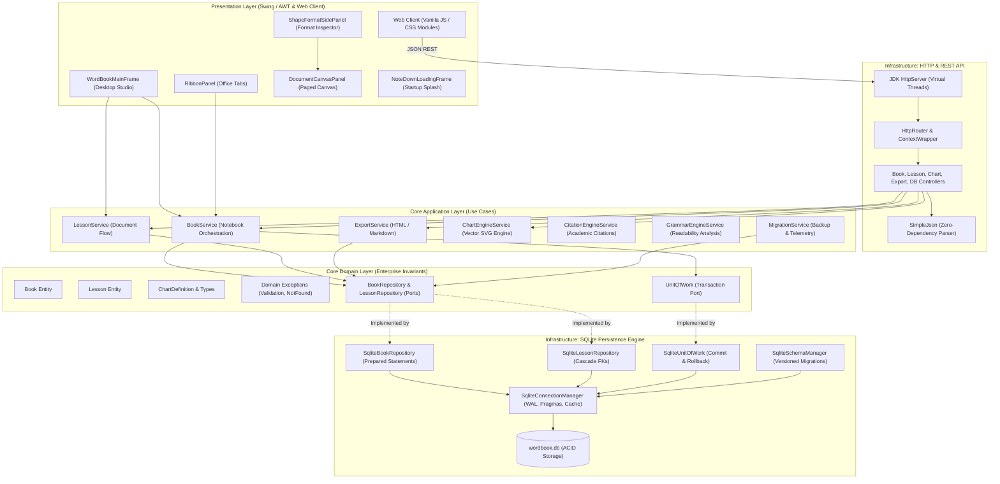
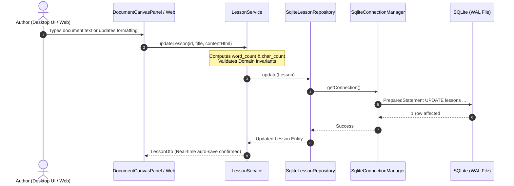

# Mikey Note — Modern Modular Java & SQLite Document Studio

<div align="center">
  

  <p><b>A state-of-the-art document studio and notebook environment re-engineered with an Advanced Modular Architecture in Java 24, SQLite ACID persistence in WAL mode, native desktop studio with an Adobe-style splash loader, and an ultra-fast Python rendering pipeline.</b></p>

  <p>
    <a href="https://github.com/DinethChanuka/Mikey-Note/actions"></a>
    
    
    
    
    
  </p>
</div>

---

## 📑 Table of Contents

- [🌟 Overview & Key Highlights](#-overview--key-highlights)
- [🏛️ System Architecture](#️-system-architecture)
  - [Clean Architecture & Domain-Driven Design (DDD)](#clean-architecture--domain-driven-design-ddd)
  - [Architecture Sequence Diagram](#architecture-sequence-diagram)
  - [Concurrency & Threading Model](#concurrency--threading-model)
- [✨ Core Features & Capabilities](#-core-features--capabilities)
  - [1. Microsoft Word-Style Ribbon Interface](#1-microsoft-word-style-ribbon-interface)
  - [2. Contextual Shape & Card Format Side Panel](#2-contextual-shape--card-format-side-panel)
  - [3. Multi-Page Word-Style Paged Canvas](#3-multi-page-word-style-paged-canvas)
  - [4. Dedicated Adobe-Style Startup Loading Frame](#4-dedicated-adobe-style-startup-loading-frame)
  - [5. 55+ Vector Cover Designs & Global Color Picker](#5-55-vector-cover-designs--global-color-picker)
  - [6. Multi-Format Vector & Raster Chart Engine](#6-multi-format-vector--raster-chart-engine)
  - [7. Academic Citation & Bibliography Engine](#7-academic-citation--bibliography-engine)
  - [8. Automated Grammar & Readability Analysis Suite](#8-automated-grammar--readability-analysis-suite)
  - [9. Standalone Python Fast Rendering Pipeline (>40,000 renders/sec)](#9-standalone-python-fast-rendering-pipeline-40000-renderssec)
  - [10. Embedded Virtual-Thread HTTP Server & SimpleJson](#10-embedded-virtual-thread-http-server--simplejson)
  - [11. Responsive Web Client & Document Studio](#11-responsive-web-client--document-studio)
- [📦 Modular Directory & Package Layout](#-modular-directory--package-layout)
- [🗄️ Database Architecture & Storage Engine](#️-database-architecture--storage-engine)
  - [SQLite PRAGMAs & WAL Mode](#sqlite-pragmas--wal-mode)
  - [Database Schema Migrations](#database-schema-migrations)
  - [Database Tables & Indexes](#database-tables--indexes)
- [🚀 Getting Started & Execution](#-getting-started--execution)
  - [Prerequisites](#prerequisites)
  - [Quick Start (One Command)](#quick-start-one-command)
  - [Command Line Options](#command-line-options)
  - [Supported Build Systems](#supported-build-systems)
- [🐍 Python Fast Rendering CLI](#-python-fast-rendering-cli)
- [🌐 REST API Specification](#-rest-api-specification)
- [🧪 Automated Testing Suite (29 Verification Suites)](#-automated-testing-suite-29-verification-suites)
- [🔧 Troubleshooting & FAQ](#-troubleshooting--faq)
- [📄 License & Authors](#-license--authors)

---

## 🌟 Overview & Key Highlights

**Mikey Note** is an enterprise-grade document engineering studio, notebook manager, and rich-text authoring suite. Built from first principles in modern Java (21/24) without heavy, bloated external frameworks, it unites the tactile richness of native desktop publishing (A4/Letter paged canvas, Microsoft Word-style Ribbon navigation, and dedicated Shape/Card formatting inspectors) with an embedded virtual-threaded REST API and lightweight Web client.

### Key Highlights:
- **Zero-Bloat Native Core**: Pure JDK desktop client leveraging Java Swing/AWT hardware rendering, JPMS modular architecture (`module-info.java`), and JDK embedded HttpServer.
- **SQLite ACID Persistence**: Configured in **Write-Ahead Logging (WAL)** mode with zero-lag concurrent reads and writes, transaction rollback safety via `UnitOfWork`, and versioned schema migrations.
- **Word-Grade Typography & Pagination**: Dynamic multi-page view calculation, real-time typing flow, caret synchronization across page boundaries, custom paper sizes (A4, Letter, Legal), and margin tuning.
- **Docked Visual Formatting Inspector**: Right-hand contextual format panel for live card background fills, border styles, elevation shadows, gradient presets, corner radii, and dimension scaling.
- **Microsecond Vector Visuals**: Embedded Java vector rendering engine complemented by a standalone Python multi-threaded rendering pipeline delivering over 40,000 SVG objects per second.
- **Rich Document Tools**: Automated grammar & spelling checks, readability metrics (Flesch-Kincaid, ARI), 5 academic citation formats (APA, MLA, Chicago, Harvard, IEEE), and 55+ vector cover watermark designs.

---

## 🏛️ System Architecture

### Clean Architecture & Domain-Driven Design (DDD)

Mikey Note enforces a strict **Hexagonal / Clean Architecture** model. Enterprise business logic and domain entities are strictly decoupled from external databases, UI frameworks, and network protocols.



### Architecture Sequence Diagram

The following sequence illustrates the decoupled, transaction-safe lifecycle when updating a note:



### Concurrency & Threading Model

- **Desktop UI (EDT)**: User interactions, ribbon clicks, caret navigation, and shape transformations run strictly on the Swing Event Dispatch Thread (EDT).
- **Non-Blocking Document Pipeline**: Heavy text mutations, word counts, and rasterization are computed asynchronously or with buffered intervals to guarantee 60 FPS input responsiveness without UI freezes.
- **Virtual-Threaded Web Server**: The embedded HTTP server spins lightweight virtual threads for incoming REST queries, providing high concurrent throughput without blocking OS threads.
- **SQLite Single-Writer Concurrent-Reader**: Through Write-Ahead Logging (`WAL`), reading queries proceed concurrently with background disk flushes without lock contention.

---

## ✨ Core Features & Capabilities

### 1. Microsoft Word-Style Ribbon Interface
- **Office Tabs**: Home, Insert, Draw, Design, Layout, References, Review, View, Card & Shape Format, Help.
- **Rich Document Controls**: Font family picker, typography sizing, bold/italic/underline/strikethrough, superscript/subscript, text highlighting, alignment, line spacing (1.0 to 3.0), block spacing, and unordered/ordered lists.
- **Insert Tools**: Tables, 2D/3D Charts, KPI Cards, Shapes, Process Sequences, Callout Boxes, Images, Online Videos, Citations, Page Breaks, and Smart Lorem Ipsum shorthand (`lorem50`, `lorem100`).
- **Global Undo/Redo**: 200-step deep memory undo stack with state snapshots and visual ribbon status indicators.

### 2. Contextual Shape, Picture & Object Format Side Panel
- **Intelligent Right-Docked Inspector**: Dynamically inspects the selected object and surfaces **only** the properties relevant to that specific object type:
  - **🖼️ Pictures / Images**: Quick filter presets (Original, B&W Grayscale, Sepia, Vivid, High Contrast, Inverted), aspect-ratio scaling (Lock ratio, Reset 100%, Fit page margin 560px, +/- 10% steps), photo borders, corner rounding (0 - 40px), drop shadows, and alignment.
  - **📊 Charts & Graphs**: Instant visualization switcher (Bar, Line, Area, Pie, Donut, KPI), 7 theme color palettes (Corporate Blue, Emerald, Violet, Amber, Crimson, Slate, Minimal), data label/legend toggles, and direct access to the live data series editor.
  - **💳 Metric / KPI Cards**: Topic/title, prominent large metric value, subtitle/trend badge, 8 color themes, background fill color, border styles, corner radius, and elevation depth.
  - **🔷 Shapes & Callouts**: Callout box presets (Info, Tip, Warning, Danger, Quote), accent line color, fill color, header and body text, and border styling.
  - **📑 Tables**: Preset table styles (Corporate Blue, Modern Slate, Emerald Green, Striped Zebra, Minimalist), quick row/column insertions and deletions, and cell coloring.
- **Responsive Width Toggle**: Standard (360px) and expanded (440px) dock width with smooth vertical scrolling.
- **Empty State Guidance**: Clean placeholder guide when no object is selected.

### 3. Multi-Page Word-Style Paged Canvas
- **Paper Geometry**: Supports A4 (595x842 pt), US Letter (612x792 pt), and US Legal (612x1008 pt).
- **Configurable Margins**: Normal (1 inch), Narrow (0.5 inch), Moderate, and Wide.
- **Stable Pagination**: Intelligent multi-page height measurement that keeps caret position stable across page splits without dropping objects or causing text displacement glitches.
- **Live Visual Elements**: Page dividers with drop shadows, page numbers, dynamic headers, and footers.

### 4. Dedicated Adobe-Style Startup Loading Frame
- **High-DPI Vector Logo**: Branded Mikey Note vector logo with smooth gradients and ambient backdrop.
- **Progress Animation**: Smooth animated progress bar with 5 initialization milestones (Core Engine, WAL Database, Invariants & Ports, Document Pipeline, Background Services).
- **Seamless Window Handoff**: Fluid transition that automatically disposes the splash loader and displays the desktop studio without screen flicker.

### 5. 55+ Vector Cover Designs & Global Color Picker
- **Vector Cover Gallery**: 55 distinct mathematical, geometric, minimalist, wave, circuit, and floral watermark patterns for notebook binders.
- **Instant Keyword Search**: Live filter covers by keywords (e.g. `minimal`, `wave`, `tech`, `lines`, `abstract`).
- **Advanced HSV Color Chooser**: Custom spectrum canvas with real-time Hex code input, RGB sliders, alpha transparency, and recent color swatches.

### 6. Multi-Format Vector & Raster Chart Engine
- **Supported Visualizations**:
  - Vertical Bar Charts & Horizontal Bar Charts.
  - Smooth Line Charts & Gradient Area Charts.
  - Pie Charts & Donut Charts.
  - Executive KPI Metric Cards with delta badges.
- **Dual Output**: Microsecond SVG vector markup generation and high-DPI BufferedImage rasterization.
- **Chart Metadata Sidecars**: Embedded JSON metadata in documents allows live re-editing of data series after insertion.

### 7. Academic Citation & Bibliography Engine
- **Citation Standards**: Fully compliant with **APA 7th Edition**, **MLA 9th Edition**, **Chicago 17th Edition**, **Harvard**, and **IEEE**.
- **In-Text Citations**: One-click insertion of parenthetical markers (e.g., `(Turing, 1950)`, `[1]`).
- **Automated Bibliography**: Compiles and formats all references in the document into an alphabetized Works Cited / References section.

### 8. Automated Grammar & Readability Analysis Suite
- **Rule-Based Grammar Engine**: Detects spelling mistakes, double words, missing capitalization, irregular punctuation, and passive voice phrasing.
- **Readability Telemetry**:
  - **Flesch Reading Ease Score** (0 - 100 index).
  - **Flesch-Kincaid Grade Level** (US school grade equivalent).
  - **Automated Readability Index (ARI)**.
  - Estimated reading time and speaking duration.

### 9. Standalone Python Fast Rendering Pipeline (>40,000 renders/sec)
- Located in [`Source/python/`](file:///Users/d/java/Mikey%20Note/Source/python), fully decoupled:
  - `chart_fast_renderer.py`: Generates SVG charts with 7 curated color palettes.
  - `image_fast_loader.py`: Generates Low-Quality Image Placeholders (LQIP) as Base64 data URLs for progressive rendering, applies image filters, and computes exact paper fit.
  - `object_render_helpers.py`: Renders callouts, process sequences, formulas, and preview tiles.
  - `fast_render_pipeline.py`: Parallel multi-threaded worker pool rendering >40,000 items/sec (~11 µs per item).
  - `render_cli.py`: Unified CLI command-line runner.

### 10. Embedded Virtual-Thread HTTP Server & SimpleJson
- **Zero Framework Footprint**: Built using standard `com.sun.net.httpserver.HttpServer` powered by virtual thread executors (`Executors.newVirtualThreadPerTaskExecutor()`).
- **SimpleJson Engine**: Custom zero-dependency recursive JSON tokenizer and parser that handles serialization, escaping, nested arrays, and records at blazing speeds without Jackson or Gson.

### 11. Responsive Web Client & Document Studio
- Hosted by the embedded server on `http://127.0.0.1:8080`.
- Built with vanilla ES6+ modules (`api.js`, `charts.js`, `dialog.js`, `tables.js`) and modular CSS (`variables.css`, `layout.css`, `ribbon.css`, `editor.css`, `charts.css`, `dialog.css`).
- Real-time synchronization with the SQLite backend.

---

## 📦 Modular Directory & Package Layout

```
Mikey Note/
├── .gitattributes                          # Git line-ending normalization & binary specs
├── .gitignore                              # Comprehensive ignore rules (DB, class, cache)
├── README.md                               # Project documentation & reference manual
│
└── Source/
    ├── Makefile                            # Standard Unix automation targets
    ├── build.sh                            # Zero-dependency Bash compilation script
    ├── run.sh                              # Desktop execution script with JVM flags
    ├── test.sh                             # Automated test suite launcher
    ├── build.gradle                        # Gradle build configuration
    ├── pom.xml                             # Maven POM configuration
    │
    ├── assets/                             # Logos, branding icons & favicons
    │   ├── mikey_note_logo.png             # Official high-resolution Mikey Note logo
    │   ├── favicon.ico                     # Window & browser tab icon
    │   └── favicon.png                     # Standard app icon
    │
    ├── loadwindow/                         # Dedicated desktop loading window assets
    │   ├── index.html                      # HTML5 interface for load window
    │   ├── style.css                       # Modern dark/light styling
    │   └── app.js                          # Initialization logic
    │
    ├── python/                             # Standalone Fast Rendering Pipeline
    │   ├── chart_fast_renderer.py          # Vector SVG chart renderer
    │   ├── image_fast_loader.py            # LQIP placeholder generator & paper fitting
    │   ├── object_render_helpers.py        # Callouts, sequences, formulas
    │   ├── fast_render_pipeline.py         # Multi-threaded batch rendering benchmark
    │   ├── render_cli.py                   # Unified CLI runner
    │   └── README.md                       # Python subsystem documentation
    │
    ├── src/
    │   ├── main/
    │   │   ├── java/
    │   │   │   ├── module-info.java        # Java Platform Module System (JPMS)
    │   │   │   └── com/wordbook/
    │   │   │       ├── WordBookApplication.java # Application bootstrap & CLI parser
    │   │   │       │
    │   │   │       ├── core/               # Pure Enterprise Domain & Application Rules
    │   │   │       │   ├── domain/
    │   │   │       │   │   ├── model/      # Book, Lesson, ChartDefinition entities
    │   │   │       │   │   ├── repository/ # BookRepository, LessonRepository, UnitOfWork ports
    │   │   │       │   │   └── exception/  # Validation, NotFound, Persistence exceptions
    │   │   │       │   └── application/
    │   │   │       │       ├── dto/        # DTO Records & Request objects
    │   │   │       │       └── service/    # BookService, LessonService, ChartEngine,
    │   │   │       │                       # CitationEngine, GrammarEngine, ExportService
    │   │   │       │
    │   │   │       └── infrastructure/     # Frameworks, Database, Web, UI Adapters
    │   │   │           ├── persistence/sqlite/ # SqliteConnectionManager, SchemaManager,
    │   │   │           │                       # SqliteBookRepository, SqliteUnitOfWork
    │   │   │           ├── web/                # HttpServer, HttpRouter, JSON Engine,
    │   │   │           │   └── controller/     # REST API Controllers (Books, Lessons, etc.)
    │   │   │           └── ui/
    │   │   │               ├── WordBookDesktopGui.java # Headless browser launcher
    │   │   │               └── swing/          # Desktop Studio: WordBookMainFrame,
    │   │   │                                   # RibbonPanel, ShapeFormatSidePanel,
    │   │   │                                   # DocumentCanvasPanel, LoadingFrame,
    │   │   │                                   # CoverDesign (55 designs), ThemeManager
    │   │   │
    │   │   └── resources/                  # Bundled assets & static web files
    │   │
    │   └── test/
    │       └── java/com/wordbook/
    │           └── WordBookTestSuite.java  # 29 Self-contained automated test suites
    │
    ├── web/                                # Static Web Client Assets
    │   ├── css/                            # Modular stylesheets (ribbon, editor, etc.)
    │   └── js/                             # ES6 modules (api.js, charts.js, tables.js)
    │
    ├── temp/                               # Temporary directories with .gitkeep
    │   ├── classes/                        # Dedicated temporary compiled test classes
    │   └── files/                          # Temporary rendered cache & samples
    │
    └── lib/                                # Project runtime libraries
        ├── sqlite-jdbc-3.49.1.0.jar        # SQLite JDBC driver
        └── javafx-sdk-24/                  # JavaFX runtime modules (optional)
```

---

## 🗄️ Database Architecture & Storage Engine

### SQLite PRAGMAs & WAL Mode

The database connection manager ([`SqliteConnectionManager.java`](file:///Users/d/java/Mikey%20Note/Source/src/main/java/com/wordbook/infrastructure/persistence/sqlite/SqliteConnectionManager.java)) initializes each connection with production-tuned PRAGMAs:

```sql
PRAGMA journal_mode = WAL;          -- Write-Ahead Logging for non-blocking concurrent reads
PRAGMA synchronous = NORMAL;        -- Durable ACID transactions without disk sync bottlenecks
PRAGMA foreign_keys = ON;           -- Enforces strict cascading deletions on relational tables
PRAGMA busy_timeout = 5000;         -- 5-second wait queue to prevent SQLite locked errors
PRAGMA cache_size = -8000;          -- 8 MB memory page cache allocation
PRAGMA temp_store = MEMORY;         -- In-memory staging for temporary queries & sorting
```

### Database Schema Migrations

The schema manager ([`SqliteSchemaManager.java`](file:///Users/d/java/Mikey%20Note/Source/src/main/java/com/wordbook/infrastructure/persistence/sqlite/SqliteSchemaManager.java)) applies versioned migrations automatically upon startup, verified against the `schema_version` registry:

```sql
CREATE TABLE IF NOT EXISTS schema_version (
    version INTEGER PRIMARY KEY,
    description TEXT NOT NULL,
    applied_at INTEGER NOT NULL
);
```

### Database Tables & Indexes

```sql
-- 1. Notebooks / Books Table
CREATE TABLE IF NOT EXISTS books (
    id TEXT PRIMARY KEY,
    title TEXT NOT NULL,
    color TEXT NOT NULL,
    created_at INTEGER NOT NULL,
    updated_at INTEGER NOT NULL
);

-- 2. Lessons / Note Documents Table
CREATE TABLE IF NOT EXISTS lessons (
    id TEXT PRIMARY KEY,
    book_id TEXT NOT NULL,
    title TEXT NOT NULL,
    content_html TEXT NOT NULL,
    word_count INTEGER NOT NULL DEFAULT 0,
    char_count INTEGER NOT NULL DEFAULT 0,
    sort_order INTEGER NOT NULL DEFAULT 0,
    created_at INTEGER NOT NULL,
    updated_at INTEGER NOT NULL,
    FOREIGN KEY (book_id) REFERENCES books(id) ON DELETE CASCADE
);

-- Performance Indexes
CREATE INDEX IF NOT EXISTS idx_lessons_book_id ON lessons(book_id);
CREATE INDEX IF NOT EXISTS idx_lessons_sort ON lessons(book_id, sort_order ASC);
CREATE INDEX IF NOT EXISTS idx_books_updated ON books(updated_at DESC);
```

---

## 🚀 Getting Started & Execution

### Prerequisites

| Component | Minimum Requirement | Recommended |
|---|---|---|
| **JDK (Java)** | Java 21 LTS | **Java 24** |
| **Python** | Python 3.9+ | Python 3.11+ |
| **Operating System** | macOS, Linux, or Windows | macOS (Apple Silicon / Intel) or Linux |
| **SQLite** | Built-in via JDBC driver | Automatic download in `build.sh` |

### Quick Start (One Command)

#### On Windows (Command Prompt or PowerShell):
```cmd
:: From repository root (or inside Source):
run.bat
```
Or via PowerShell:
```powershell
.\run.ps1
```

#### On macOS & Linux (Bash / Zsh):
```bash
# From repository root:
./run.sh

# Or from Source/:
cd Source && ./run.sh
```

This single command will:
1. Verify the SQLite JDBC driver exists (downloading it automatically if needed).
2. Compile all Java source files into `bin/`.
3. Launch the **NoteDown Loading Frame** with progress animation.
4. Apply any pending SQLite database migrations.
5. Initialize the embedded background HTTP server on `http://127.0.0.1:8080`.
6. Open the native **Mikey Note Desktop Studio** with ribbon controls, multi-page canvas, and formatting panels.

### Command Line Options

You can launch Mikey Note with various runtime flags on both Windows and Unix:

```bash
# Windows
run.bat [options]
# macOS / Linux
./run.sh [options]
# or directly via JAR:
java -jar Source/wordbook.jar [options]
```

| Flag | Parameter | Description | Default |
|---|---|---|---|
| `-p`, `--port` | `<number>` | Port number for the embedded HTTP server | `8080` |
| `-h`, `--host` | `<ip>` | Host address to bind the server | `127.0.0.1` |
| `-d`, `--db` | `<path>` | Custom path to the SQLite database file | `wordbook.db` |
| `--headless` | *none* | Run server only in headless mode (no GUI) | `false` |
| `--stats` | *none* | Output database telemetry & size diagnostics, then exit | — |
| `--migrate` | *none* | Execute database migrations and exit | — |
| `--import` | `<file>` | Import a JSON backup file into SQLite and exit | — |
| `--help` | *none* | Display the command-line help screen | — |

#### Diagnostic Stats Example:
```bash
cd Source
java -cp "lib/sqlite-jdbc-3.49.1.0.jar:bin" com.wordbook.WordBookApplication --stats
```

### Supported Build Systems

Mikey Note supports multiple build systems out of the box:

#### 1. Zero-Dependency Native Bash Scripts
```bash
cd Source
./build.sh       # Compiles classes & packages wordbook.jar
./run.sh         # Runs the native application
./test.sh        # Runs the 29-suite test harness
```

#### 2. Unix Makefile
```bash
cd Source
make build       # Compile classes and package JAR
make run         # Launch desktop application
make test        # Compile and execute test suite
make stats       # Print database statistics
make clean       # Remove bin/, temp classes, and temporary databases
```

#### 3. Apache Maven
```bash
cd Source
mvn clean compile
mvn package
mvn exec:java -Dexec.mainClass="com.wordbook.WordBookApplication"
```

#### 4. Gradle
```bash
cd Source
gradle build
gradle run
```

---

## 🐍 Python Fast Rendering CLI

The Python subsystem can be executed standalone for high-performance rendering tasks:

```bash
cd Source

# 1. Run parallel batch benchmark and generate visual demo gallery
python3 -m python.render_cli

# 2. Compute exact page dimension fitting for A4 paper (1920x1080 image)
python3 -m python.render_cli --fit 1920 1080 --paper A4

# 3. Generate a Low-Quality Image Placeholder (LQIP) Base64 Data URL
python3 -m python.render_cli --lqip assets/mikey_note_logo.png
```

### Benchmark Throughput:
```
[Benchmark] Completed 1,000 renders in 24.18 ms (41,356.5 objects/sec, 24.18 µs/render)
[Demo Gallery] Generated 12 sample SVGs in temp/files/rendered_samples/
```

---

## 🌐 REST API Specification

The embedded virtual-thread server provides a full RESTful API for headless usage, automations, or web clients:

### Endpoint Overview

| Method | Route | Description | Request Body | Response |
|---|---|---|---|---|
| `GET` | `/api/books` | List all notebooks with lesson counts | *None* | `ApiResponse<List<BookDto>>` |
| `POST` | `/api/books` | Create a new notebook | `{"title": "...", "color": "..."}` | `ApiResponse<BookDto>` |
| `GET` | `/api/books/:id` | Fetch notebook by ID with its lessons | *None* | `ApiResponse<BookWithLessonsDto>` |
| `PUT` | `/api/books/:id` | Update notebook title or color | `{"title": "...", "color": "..."}` | `ApiResponse<BookDto>` |
| `DELETE` | `/api/books/:id` | Delete notebook & cascade lessons | *None* | `ApiResponse<Map>` |
| `GET` | `/api/books/:id/lessons` | List all lessons inside a notebook | *None* | `ApiResponse<List<LessonDto>>` |
| `POST` | `/api/books/:id/lessons` | Create a new lesson document | `{"title": "...", "contentHtml": "..."}` | `ApiResponse<LessonDto>` |
| `GET` | `/api/lessons/:id` | Retrieve single lesson details | *None* | `ApiResponse<LessonDto>` |
| `PUT` | `/api/lessons/:id` | Update lesson title & content | `{"title": "...", "contentHtml": "..."}` | `ApiResponse<LessonDto>` |
| `DELETE` | `/api/lessons/:id` | Delete a specific lesson | *None* | `ApiResponse<Map>` |
| `GET` | `/api/lessons/:id/export/html` | Download standalone styled HTML file | *None* | Standalone HTML |
| `GET` | `/api/lessons/:id/export/md` | Download clean Markdown document | *None* | Clean Markdown |
| `GET` | `/api/books/:id/export/html` | Export entire notebook as single doc | *None* | Binder HTML |
| `POST` | `/api/charts/render` | Server-side SVG chart rendering | `{"type": "BAR", "labels": [...], ...}` | `ApiResponse<Map>` (SVG markup) |
| `GET` | `/api/db/stats` | Telemetry, file sizes & lesson stats | *None* | `ApiResponse<SystemStatsDto>` |
| `GET` | `/api/db/export` | Complete JSON database backup | *None* | Full JSON Dump |
| `POST` | `/api/db/import` | Restore database from JSON backup | JSON Backup Payload | `ApiResponse<Map>` |

### Example Request & Response

#### Create a Notebook:
```bash
curl -X POST http://127.0.0.1:8080/api/books \
  -H "Content-Type: application/json" \
  -d '{"title": "Computer Science Research", "color": "#2563EB"}'
```

```json
{
  "success": true,
  "data": {
    "id": "book_9f83a1b2",
    "title": "Computer Science Research",
    "color": "#2563EB",
    "lessonCount": 0,
    "createdAt": 1793174693000,
    "updatedAt": 1793174693000
  },
  "error": null,
  "timestamp": 1793174693025
}
```

---

## 🧪 Automated Testing Suite (29 Verification Suites)

Mikey Note features an exhaustive, zero-dependency test suite verifying domain rules, persistence invariants, SVG rendering, and multithreaded EDT safety:

```bash
cd Source
./test.sh
```

### Verification Suite Breakdown:

```
==================================================
  Running WordBook Modular Architecture Tests     
==================================================

 [1] SimpleJson Serializer & Parser             ✔ Passed (Escaping, nested objects, arrays)
 [2] ChartEngineService SVG Generation          ✔ Passed (Bar, line, pie, donut, KPI)
 [3] Chart Image Rasterization & Auto-Detect    ✔ Passed (PNG rasterization, MIME checks)
 [4] Chart Metadata Sidecar & Re-Rendering      ✔ Passed (Round-trip metadata preservation)
 [5] DocumentCanvasPanel Page Setup & Margins   ✔ Passed (A4, Letter, Legal margin logic)
 [6] CitationEngineService Formatting           ✔ Passed (APA, MLA, Chicago, Harvard, IEEE)
 [7] GrammarEngineService Typo & Spacing        ✔ Passed (Passive voice, Flesch scores)
 [8] DocumentStructureDetector Auto-Detection   ✔ Passed (Headings outline, reading time)
 [9] SQLite In-Memory Database & Transactions   ✔ Passed (ACID commit, rollback, WAL)
[10] Domain Models & Invariants                 ✔ Passed (Validation exceptions, immutability)
[11] ExportService HTML & Markdown Generation   ✔ Passed (Standalone HTML & MD conversion)
[12] Table Tools, Contextual Tabs & Shapes      ✔ Passed (Cell formatting, zebra striping)
[13] AdvancedUndoManager High-Level Memory      ✔ Passed (200-step memory history stack)
[14] Internet Scraper & Smart Accessibility     ✔ Passed (WCAG contrast, image alt audits)
[15] HTTP REST Server & SQLite End-to-End       ✔ Passed (Virtual-threaded route assertions)
[16] ProxyRoutingManager & Visual Cards         ✔ Passed (Proxy routing, card visual models)
[17] Redesigned Ribbon & Visual Elements        ✔ Passed (Ribbon tab dispatching & state)
[18] Expanded Chart Types & Card Backgrounds    ✔ Passed (Custom palette rendering)
[19] Word-Style Pagination & Contextual Tabs    ✔ Passed (Page break stability & split rules)
[20] Claude Designed Chart Components           ✔ Passed (Catalog, palette picker, ThumbCard)
[21] Non-Blocking Mutations & EDT Safety        ✔ Passed (Asynchronous typing responsiveness)
[22] Header/Footer Styles & Dynamic Cards       ✔ Passed (Page numbering & clamped zoom)
[23] Global Ribbon Undo/Redo & Lesson Manager   ✔ Passed (Document lifecycle & reordering)
[24] Smart Lorem Ipsum Shorthand Expander       ✔ Passed (Dynamic pseudo-latin generator)
[25] Context Menu & Block Line Spacing          ✔ Passed (Right-click menus, 1.0-3.0 spacing)
[26] Chart Glitch & Displacement Fixes          ✔ Passed (Zero-layout-shift image loading)
[27] Image Filters, Canvas Fitting & Smooth Sizing ✔ Passed (Aspect ratio preservation)
[28] Realistic Preview Cards & Inline Editing   ✔ Passed (Visual card selection & resize)
[29] Shape Format Side Panel & Multi-Page View  ✔ Passed (Right inspector dock & pagination)
==================================================
  Results: 29 Passed, 0 Failed
==================================================
```

---

## 🔧 Troubleshooting & FAQ

### 1. Port 8080 is already in use
**Symptom:** `[Service] Port 8080 is busy, finding open port...`  
**Solution:** Mikey Note automatically detects port collisions and auto-binds to the next available port in the range `8080-8100`. You can also specify an exact open port using `./run.sh --port 9090`.

### 2. SQLite Database is Locked
**Symptom:** `org.sqlite.SQLiteException: [SQLITE_BUSY] The database file is locked`  
**Solution:** Mikey Note automatically sets `PRAGMA busy_timeout = 5000;` and runs in **WAL mode**. If another external tool locked the file, ensure no zombie processes are holding `wordbook.db`:
```bash
lsof Source/wordbook.db
kill -9 <PID>
```

### 3. Java Runtime Version Mismatch
**Symptom:** `java.lang.UnsupportedClassVersionError: ... has been compiled by a more recent version of the Java Runtime`  
**Solution:** Mikey Note requires Java 21 or Java 24. Verify your active JDK version:
```bash
java -version
javac -version
```
If needed, set your `JAVA_HOME` environment variable to a JDK 21+ installation.

### 4. Native Access Warning on Startup
**Symptom:** `WARNING: A restricted method in java.lang.System has been called`  
**Solution:** This is expected when the SQLite JDBC driver loads native C-bindings on modern JDKs. The provided [`run.sh`](file:///Users/d/java/Mikey%20Note/Source/run.sh) script includes `--enable-native-access=ALL-UNNAMED` to suppress this warning.

---

## 📄 License & Authors

This project is licensed under the **MIT License** — see the license headers in source files for full details.

Created and engineered by **Dineth Chanuka** ([@DinethChanuka](https://github.com/DinethChanuka)).

*Mikey Note — Modern Modular Java & SQLite Document Studio.*
